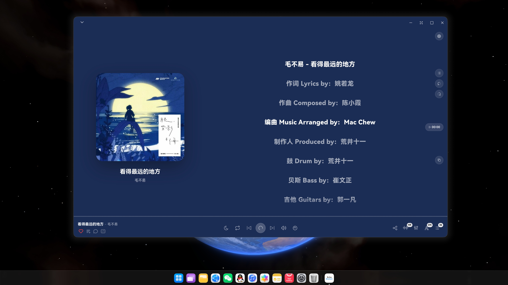
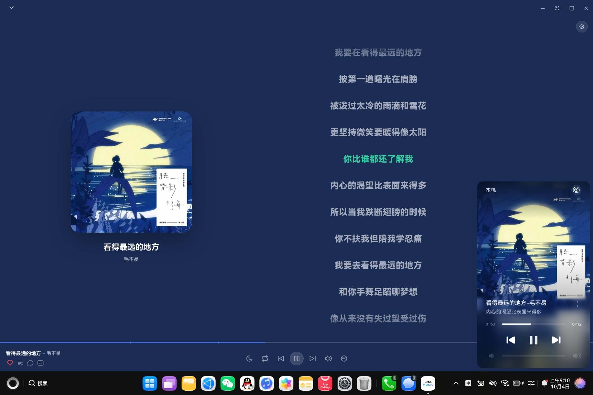
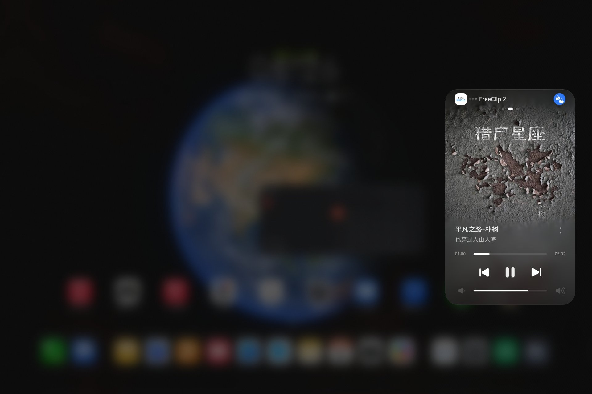
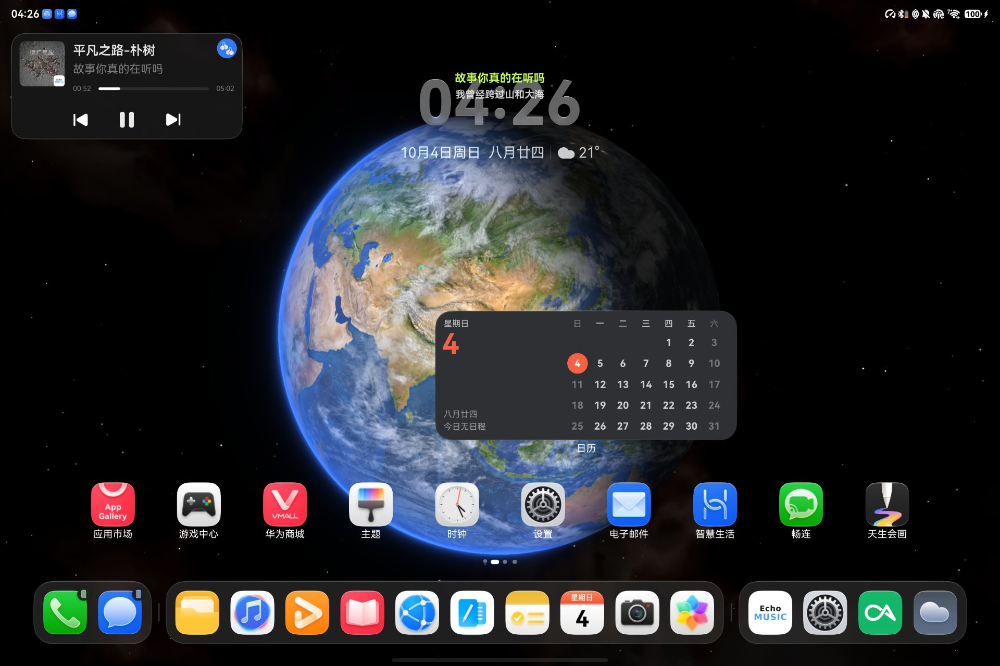
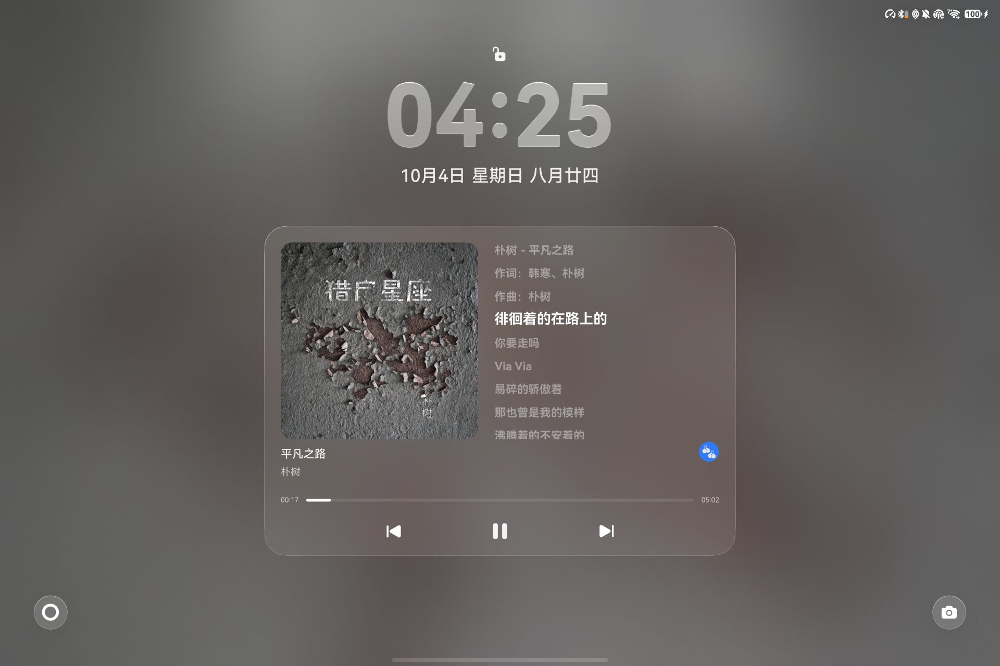
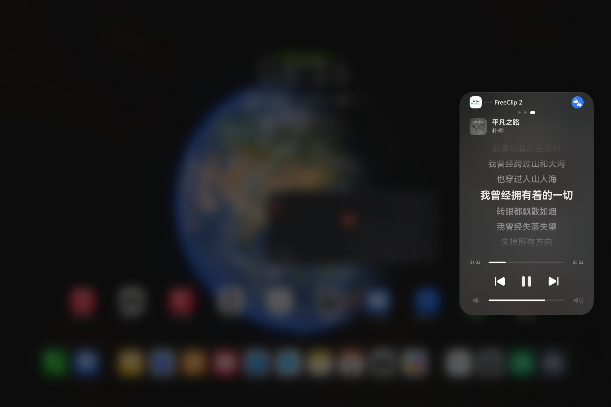
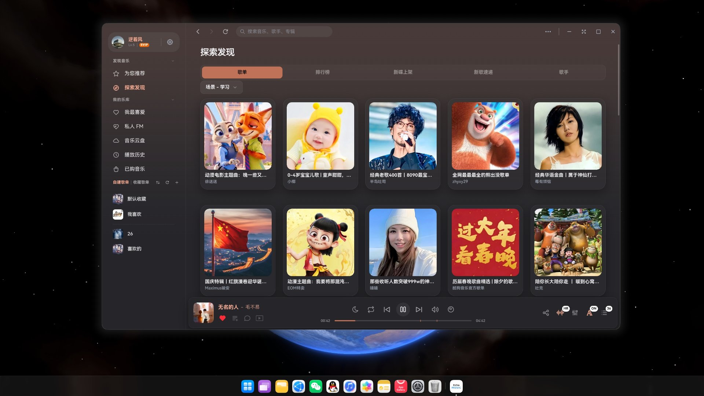
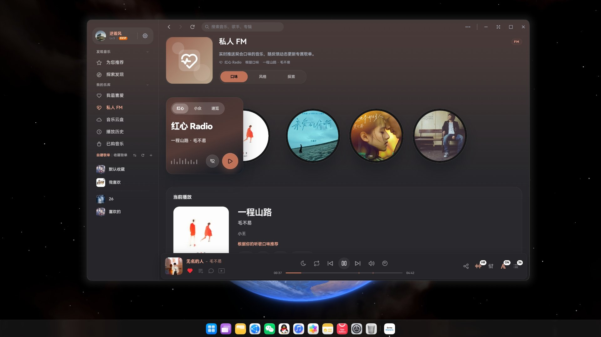
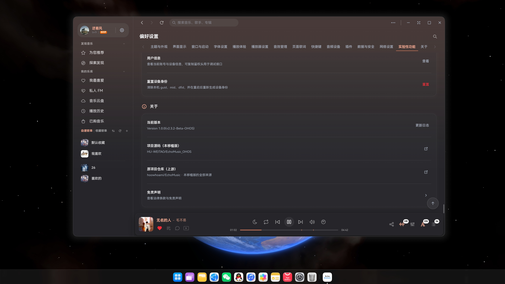
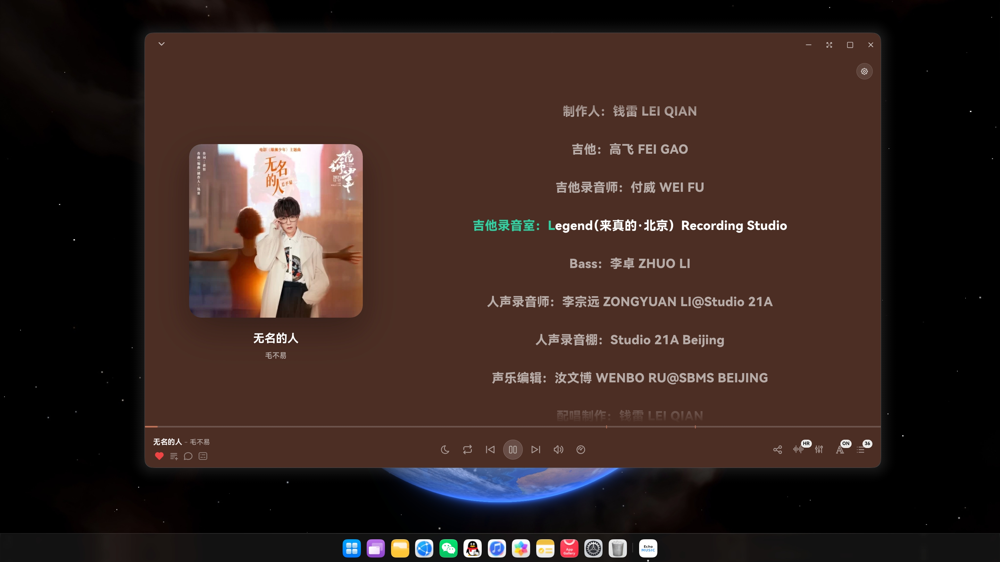

# EchoMusic 鸿蒙版

<p align="center">
  
</p>

<p align="center">
  <strong>EchoMusic 鸿蒙版</strong> —— 上游 <a href="https://github.com/hoowhoami/EchoMusic">EchoMusic</a> 的 HarmonyOS 移植版本。
</p>

<p align="center">
  
  
  
  
  
  
  
</p>

> **当前载荷基线：上游 v2.3.2（2026-10-26 正式版）**，移植版本号 `1.2.0`。
> 与上游的功能差异见下文「相对上游 v2.3.2 的功能差异」。

---

## ⚠️ 移植声明

> **本项目是开源项目 [hoowhoami/EchoMusic](https://github.com/hoowhoami/EchoMusic) 的 HarmonyOS（鸿蒙）移植版本，不是原创项目。**
>
> 上游作者 [@hoowhoami](https://github.com/hoowhoami)，协议 GPL-3.0。**播放器本体（界面、交互、插件体系、音效引擎、本地服务、数据接口）全部来自上游**，本仓库只负责鸿蒙平台适配。
>
> 上游更新不会自动同步，两边独立演进。本移植版同样以 GPL-3.0 发布，衍生关系与改动范围见 [NOTICE.md](NOTICE.md)。

---

## 📸 界面演示

<p align="center">
  
  <br>
  <em>播放页：逐行歌词、桌面歌词开关入口</em>
</p>

<p align="center">
  
  
  <br>
  <em>左：控制中心媒体面板　右：下拉控制中心</em>
</p>

<p align="center">
  
  
  <br>
  <em>左：桌面迷你播放卡片　右：锁屏歌词</em>
</p>

<p align="center">
  
  
  <br>
  <em>左：下拉控制中心迷你歌词　右：私人 FM</em>
</p>

<p align="center">
  
  
  <br>
  <em>左：探索发现（歌单 / 排行榜 / 新碟）　右：专辑详情与制作人员</em>
</p>

<p align="center">
  
  <br>
  <em>设置页：关于、版本号与开源仓库入口</em>
</p>

---

## ✨ 核心特性

- **播放**：播放队列、播放模式、音量、进度拖动、倍速、淡入淡出切歌
- **内容**：歌曲 / 歌单 / 歌手 / 专辑 / 排行榜推荐，全维度搜索
- **歌词**：LRC / YRC 逐字歌词、翻译、正则过滤、滚动同步、全屏歌词、写真模式
- **歌单导入**：网易云、QQ 音乐、酷我、酷狗、汽水、Spotify、Apple Music
- **音效**：10 段均衡器、LUFS 响度标准化、WAV / IRS 空间音效
- **实时频谱**：直接从播放引擎取音频做 FFT，供插件消费
- **插件系统**：在线插件源 + 本地插件，可扩展页面、侧边栏、设置项、播放器按钮
- **系统媒体控制**：鸿蒙上接入 **AVSession + 媒体实况窗**（锁屏 / 状态栏胶囊）
- **其它**：私人 FM、音乐云盘、听歌识曲、歌曲评论、分享、持久化

## 🔧 鸿蒙适配

- **系统媒体**：AVSession 会话、元数据与播放态推送，支持 `play` `pause` `playNext` `playPrevious` `seek` `fastForward` `rewind`
- **后台播放**：`backgroundModes: audioPlayback` + `KEEP_BACKGROUND_RUNNING` + 长时任务保活
- **媒体实况窗**：系统指引只要求声明 `backgroundModes` + 接 AVSession，实测**必须再申请长时任务**才唤起
- **设备类型**：`deviceTypes` **必须包含 `phone`**，否则被判定为 PC 端应用，回桌面只最小化不退后台，实况窗不显示
- **沉浸式窗口**：隐藏状态栏与小横条；注意**隐藏后 `getWindowAvoidArea()` 仍返回非 0**，首帧不能按避让区裁剪
- **窗口形态约束**：`module.json5` 声明式限制自由窗口尺寸与宽高比（`minWindowRatio` 1.0 / `maxWindowRatio` 2.5），避免 WebView 壳响应式布局错位
- **系统窗口三键**：自由多窗下系统会叠一层三键，`setWindowDecorVisible(false)` 只关标题栏本体，需另行 `setWindowTitleButtonVisible()`
- **多进程**：`childProcessManager` + 独立 `:browser` 进程，渲染走 ArkWeb 容器
- **状态栏扩展**：`statusBarView` ExtensionAbility
- **系统能力适配**：45 个 ArkTS Adapter 覆盖窗口、通知、剪贴板、分享、文件选择器、权限、证书、显示、蓝牙、输入等，配 44 个 ipc 桥
- **原生模块**：上游 4 个 Rust napi 模块（播放 / 采集 / 媒体控制 / SQLite）用鸿蒙交叉工具链重编为 arm64-v8a
- **日志**：统一 `LogUtil` 封装 `hilog`，`console.*` 已清零
- **版本落差**：上游按 Electron 43.x API 编写，实际容器是 Electron 34.x（Chromium 132），34 之后新增的 API 不可用

## 🛠️ 技术栈

**鸿蒙侧（适配层）**

- **Application**: ArkTS + ArkUI 声明式
- **SDK**: API 23（HarmonyOS 6.1.0）
- **Build**: DevEco Studio 6.1.0 + hvigor + ohpm
- **Runtime**: Electron 鸿蒙化运行时（Electron 34.x · Chromium 132.0.6834.161，`libelectron.so`）
- **Renderer**: ArkWeb `@kit.ArkWeb`
- **Media**: `@kit.AVSessionKit` · `@kit.BackgroundTasksKit` · `@kit.DeskTopExtensionKit`
- **Window**: `@kit.AbilityKit` · `@kit.WindowKit` · `@kit.BasicServicesKit`
- **Data**: `@kit.ArkData`（preferences）+ SQLite
- **Bridge**: C++ NAPI（`libadapter.so`）
- **Native**: Rust + [napi-rs](https://napi.rs/)，arm64-v8a
- **Logging**: `hilog`
- **Target**: arm64-v8a

**上游侧（容器内原样运行，未改）**

- **Desktop Shell**: [Electron](https://www.electronjs.org/) 43.x API（上游源码声明）
- **Frontend**: [Vue 3.5](https://vuejs.org/) + [TypeScript 5.9](https://www.typescriptlang.org/)
- **Build Tool**: [Vite](https://vite.dev/) 8 + esbuild
- **State Management**: [Pinia](https://pinia.vuejs.org/) 3
- **UI Primitives**: [Reka UI](https://reka-ui.com/) + [Tailwind CSS](https://tailwindcss.com/) 4.3 + Iconify
- **Routing**: [Vue Router](https://router.vuejs.org/)
- **Backend Service**: [Node.js](https://nodejs.org/) + Express（内置本地服务）
- **Audio Engine**: FFmpeg 解码 + SoundTouch 变速（`libffmpeg.so`）
- **Native Addons**: [napi-rs](https://napi.rs/) ×4
- **Package Manager**: pnpm

---

## 🚀 快速开始

### 前置要求

- [DevEco Studio](https://developer.huawei.com/consumer/cn/deveco-studio/) **6.1.0**（含 API 23 SDK）
- 设备类型 `phone` / `tablet` / `2in1`
- 目标架构 **arm64-v8a**
- 首次 Sync 需联网（执行 `ohpm install`）

### 编译

```bash
# 签名：DevEco → File → Project Structure → Project → Signing Configs
#      勾选 Automatically generate signature（需登录华为账号）
# 本仓库不含任何证书文件，build-profile.json5 中的 signingConfigs 需替换为本地值

ohpm install
hvigorw assembleHap --mode module -p product=default -p buildMode=debug --no-daemon
```

产物：`electron/build/default/outputs/default/electron-default-signed.hap`

详细步骤与离线编译说明见 [README-编译说明.md](README-编译说明.md)。

### ⚠️ 仓库内两块不可再生成的资产

1. `electron/libs/arm64-v8a/`（8 个原生库，180 MB）—— 目标机无交叉工具链，**删了补不回来**
2. `web_engine/src/main/resources/resfile/` —— 上游 Electron 载荷（主进程 bundle + 前端 dist + 本地 Node 服务）

> `libelectron.so` 单文件 159 MB，超过 GitHub 单文件 100 MB 上限。完整推送需 **Git LFS**，或按 `.gitignore` 排除后用 Release 附件提供。

## 🧩 相对上游 v2.3.2 的功能差异

本移植版载荷基线为上游 **v2.3.2（2026-10-26 正式版）**。下表按「为什么不可用」分类，
标注每项在上游的实现依赖，便于判断是否值得继续补齐。

### 一、无 arm64 原生模块（功能降级，不崩溃）

上游 v2.3.2 把部分能力下沉到新的 Rust/C++ napi 模块，本移植版只交叉编译了 4 个
（播放器 / 音频采集 / 媒体控制 / SQLite），以下 3 个**缺少鸿蒙产物**：

| 功能 | 依赖模块 | 当前表现 | 补齐难度 |
| --- | --- | --- | --- |
| 歌词简繁转换（原文/简体/繁体/异体/台湾正体/香港繁体） | `echo-opencc` | 设置项保留，转换调用失败后**回退原文**，歌词正常显示但不变体 | 中：OpenCC + C++ 交叉编译，词典体积大 |
| DLNA 投放（发现/连接局域网设备） | `echo-upnp` | 设备列表为空，投放入口无设备可选 | 中：Rust + SSDP/SOAP，交叉编译可行 |
| AirPlay 投放 | `echo-airplay` | 同上 | 高：需 mDNS + RAOP 协议栈 |

`echo-platform-adaptor`、`echo-native-log` 不需要鸿蒙产物：前者只在 `win32`/`darwin`
分支被调用，后者是其它原生模块内部的日志库，不是独立 addon。

### 二、鸿蒙壳层无对应系统能力（已做等价替代或明确关闭）

| 功能 | 上游实现 | 鸿蒙处置 |
| --- | --- | --- |
| 系统托盘 / 托盘菜单 | Electron `Tray` | **状态栏图标 + 菜单**替代（壳层 StatusBarExtension），左键显隐、菜单含退出 |
| 桌面歌词窗（独立透明 BrowserWindow，横/竖排、置顶、样式自定义） | 第二个 BrowserWindow | 改用**系统桌面歌词组件**（AVSession `setDesktopLyricVisible`）；歌词内容、显隐联动保留，**样式自定义与横竖排不提供** |
| 迷你播放器（mini 窗） | 第二个 BrowserWindow | **改为同窗内联实现**：主窗口自身收缩成 360×64 迷你条，迷你界面挂在同一渲染进程里；拖动、展开、置顶均可用。设备不允许缩小窗口时自动回退主界面 |
| 全局快捷键 | `globalShortcut` | **关闭**：每次注册都会拉起系统授权弹窗；设置项强制置为关闭 |
| 开机自启 | `setLoginItemSettings` | **跳过**：壳层实现会直接跳转系统设置页 |
| 应用内更新（检查/下载/静默安装） | `electron-updater` | **关闭**；关于页移除更新检查与更新开关，版本号固定显示 |
| Windows 任务栏歌词 / 缩略图 / 封面预览 | `echo-platform-adaptor`（win32） | 不适用 |
| Windows 10 透明/毛玻璃、窗口材质 | DWM API | 不适用（无对应合成器接口） |
| macOS Dock / 菜单栏图标隐藏、后台模式 | AppKit | 不适用 |
| 自动最大化动画 | 原生 `maximize()` | 改为**直接按屏幕/工作区 setBounds**，避免两段动画 |

### 三、保留但需按设备能力验收

这些能力链路完整、依赖的 4 个原生模块都在，但受设备/系统限制需实测：

- **听歌识曲**：依赖 `echo-audio-capture` 采集系统音频，需系统「音频捕获」授权
- **音效引擎**：卷积/参数音效、蝰蛇音质、DSP 模块由 `echo-audio-player` 承担，随播放器可用性而定
- **MV 播放**：走 FFmpeg（`libffmpeg.so`）+ 渲染层 `<video>`，需验证硬解与音画同步
- **插件系统**：插件市场、插件页面、本地 WebSocket API（本次新增 `ws` 依赖）、文件授权与流式下载
- **音乐云盘上传**：依赖系统文件选择器（`FilePickerAdapter`）
- **一起听 / 好友私信 / 刷歌 / 多账号切换**：纯网络 + 渲染层，无平台耦合
- **窗口形态**：自由窗口尺寸与宽高比已在 `module.json5` 声明式限制

### 四、运行时落差（Electron 34 vs 上游 43）

上游按 Electron 43 API 编写，鸿蒙容器实际是 **Electron 34.x / Chromium 132**。
34 之后新增的 API 在本环境不可用；本次升级已确认新载荷使用的
`protocol.registerSchemesAsPrivileged`、`utilityProcess`、`nativeTheme` 等均为 34 已有接口。

## ⚠️ 已知限制

- 仅在 arm64-v8a 上验证，未做 x86_64
- 桌面独占能力不可用：系统托盘、全局快捷键、开机自启、桌面歌词窗、自动更新
- 迷你播放器依赖**自由窗口模式**（PC / 2in1）；平板全屏模式下系统不允许缩窗，
  会打印 `[MiniPlayer] ohos in-place window cannot shrink` 并自动回退主界面
- 听歌识曲、音乐云盘、插件系统、音效引擎等在鸿蒙侧的完整可用性**尚未逐项验收**
- `supportWindowMode` 含 `floating`：若实况窗不再出现，用 `module.json5.bak-nosplit` 回退

## 📄 免责声明

- 基于公开 API 接口开发的第三方音乐客户端，**仅供个人学习和技术研究使用**
- 所有音乐数据通过公开接口获取，**不存储、不传播任何音频文件**
- 音乐内容版权归原平台及版权方所有，请尊重知识产权、支持正版音乐
- **禁止用于任何商业用途或违法行为**，产生的任何纠纷或损失由使用者自行承担
- 如版权方认为本项目侵犯其权益，请通过 Issues 联系
- **本项目不接受任何商业合作、广告或捐赠**

## ⚖️ 开源协议

基于 [GNU General Public License v3.0](LICENSE) 发布，与上游 [hoowhoami/EchoMusic](https://github.com/hoowhoami/EchoMusic) 保持一致。

- 衍生关系与修改范围：见 [NOTICE.md](NOTICE.md)
- 上游第三方组件授权：见上游仓库的 `THIRD_PARTY_NOTICES.md`
- 二次分发二进制包时，须同时提供完整对应源码、协议全文与衍生声明

## 💡 灵感来源

本项目基于以下开源项目：

- [KuGouMusicApi](https://github.com/MakcRe/KuGouMusicApi) - 酷狗音乐 NodeJS 版 API
- [SPlayer](https://github.com/imsyy/SPlayer) - 一个简约的音乐播放器
- [ffmpeg-audio](https://github.com/apoint123/ffmpeg-audio) - 基于 FFmpeg 的 Rust 音频解码库
- [soundtouch-rs](https://github.com/apoint123/soundtouch-rs) - Rust 音频变速处理库
- [MoeKoeMusic](https://github.com/MoeKoeMusic/MoeKoeMusic) - 一款开源简洁高颜值的酷狗第三方客户端

Electron 鸿蒙化运行时来自华为 OpenHarmony / Electron 适配工程。
